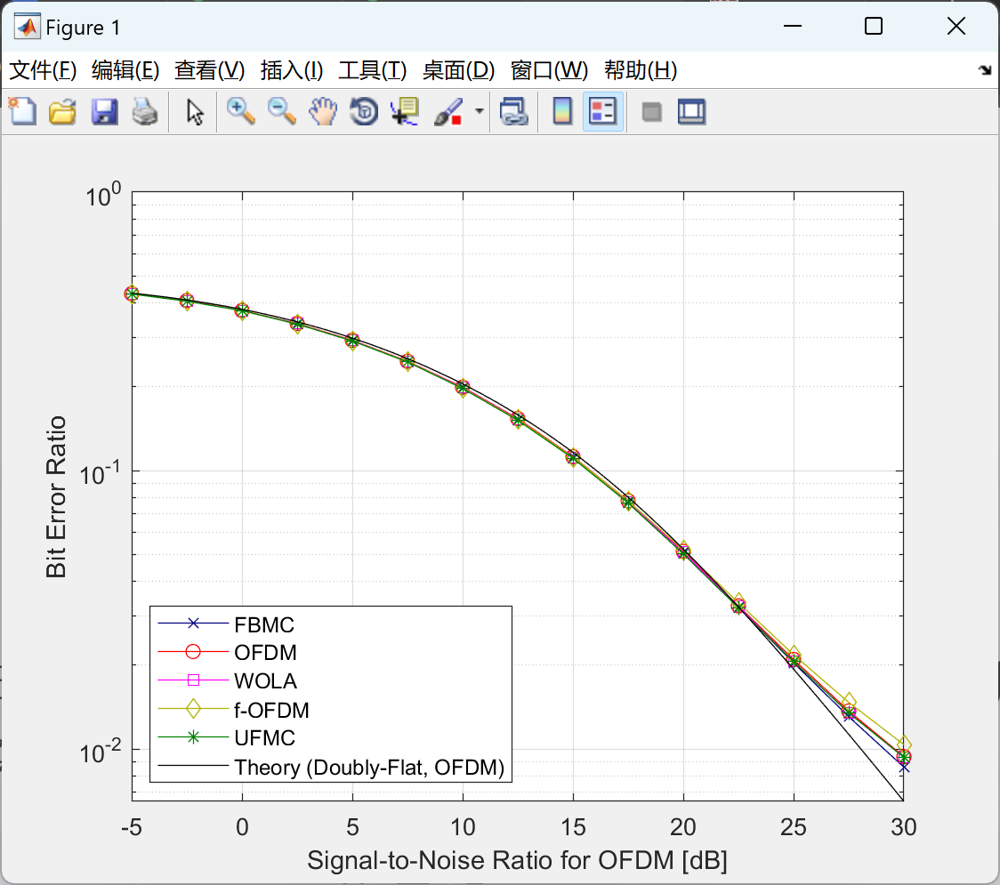
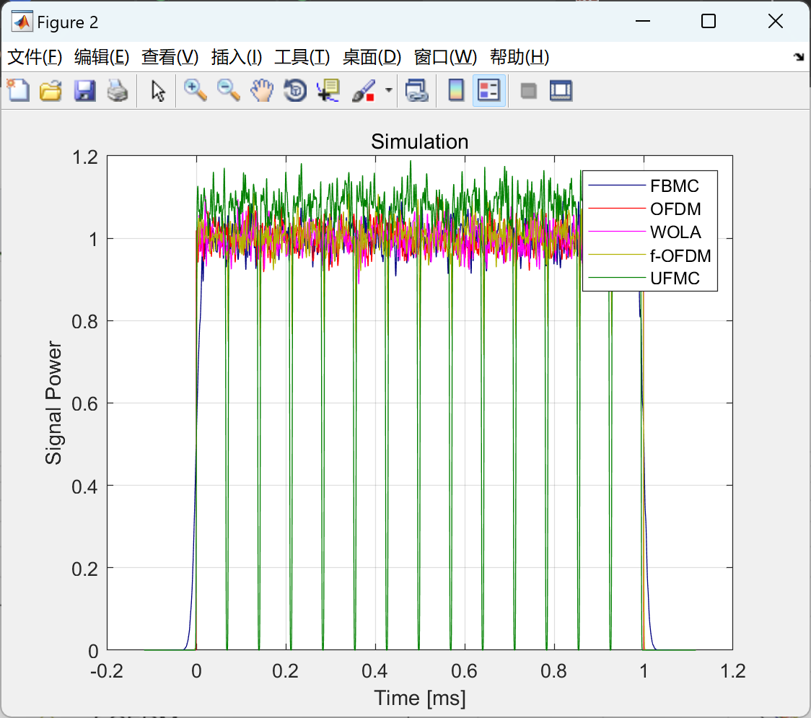
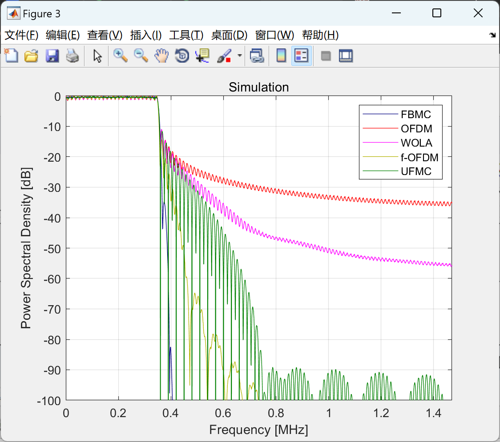

# Channel Estimation, MIMO, FBMC: Future Mobile Communications Filter Group Multicarrier Modulation Scheme (Matlab Code Implementation)

\n     \n  
\n     \n      \n        \n  
\n        \n  
Future Mobile Communications Filter Group Multicarrier Modulation Scheme with Channel Estimation and MIMO (Matlab Code Implementation)

## Images

<!-- PAYMENT_BLOCK -->

## Get this dataset

- Payment link (Stripe): [Buy now](https://buy.stripe.com/3cs8yP7sY87d0vu9AB)
- Payment QR code: 

<!-- /PAYMENT_BLOCK -->
